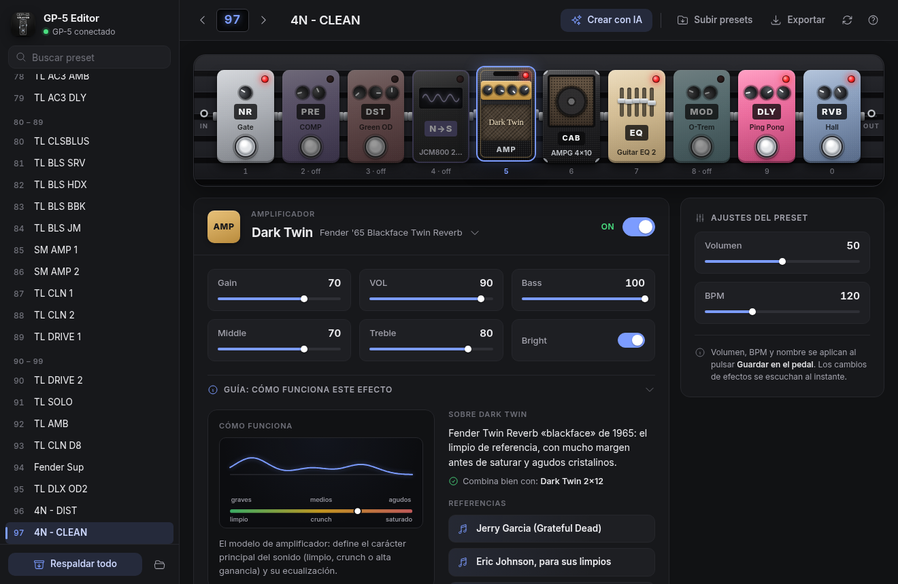
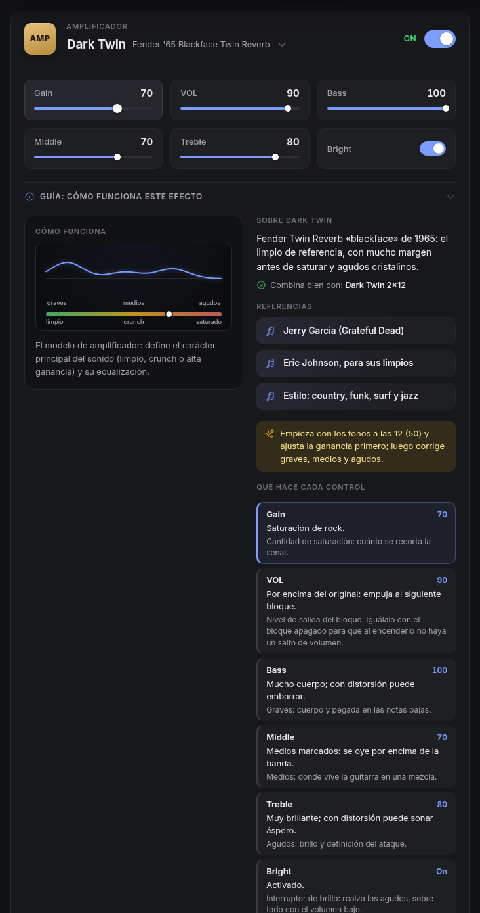
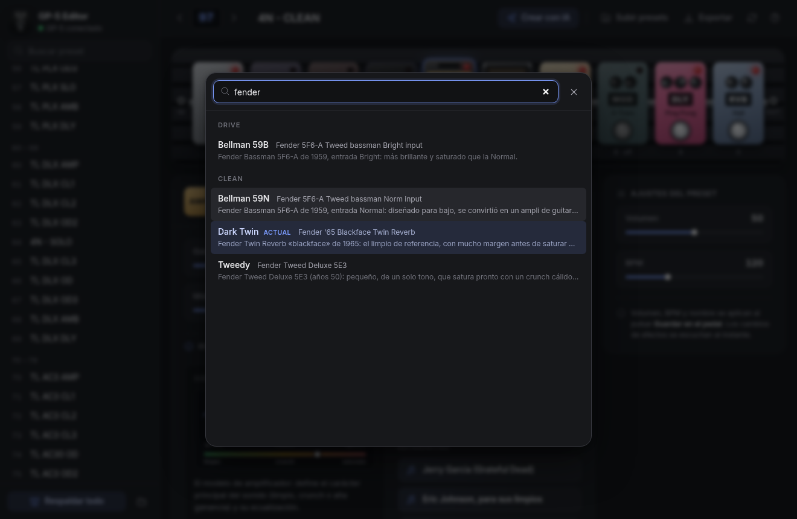
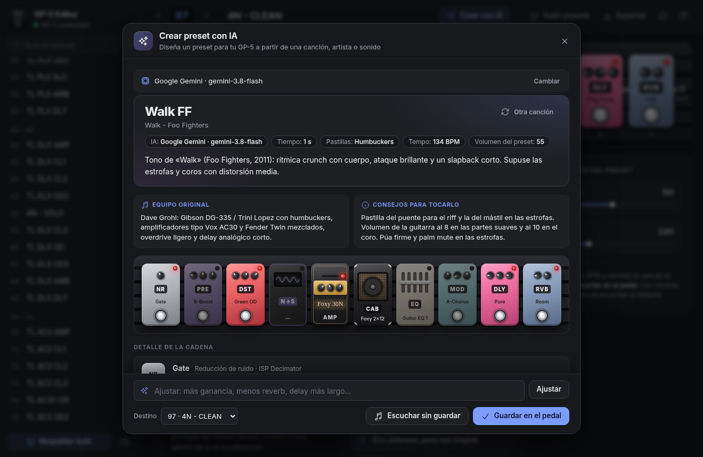
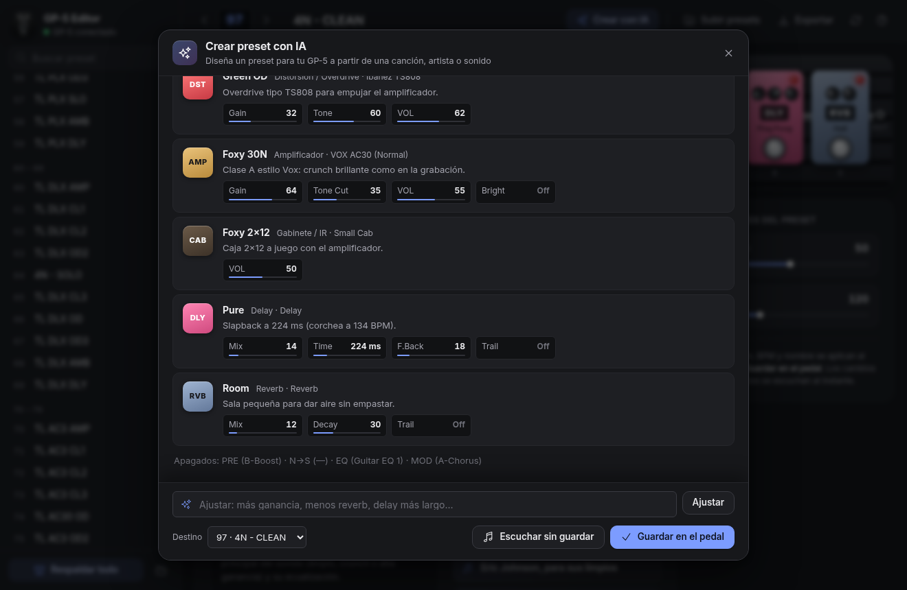

<p align="center">
  
</p>

<h1 align="center">GP-5 Editor</h1>

<p align="center">Editor web para el <b>Valeton GP-5</b> (y GP-50) por USB: edición en vivo, pedalboard visual y presets creados con IA.</p>

> Derivado de **[valeton-gp50](https://github.com/drewmerc302/valeton-gp50)** de
> [drewmerc302](https://github.com/drewmerc302). Su ingeniería inversa del protocolo MIDI del
> GP-50/GP-5 y del formato `.prst` es la base de este proyecto. Aquí se rehízo como editor web para el
> GP-5, con edición en vivo, pedalboard visual, creación de presets con IA y soporte del protocolo
> propio del GP-5 (guardar con `0x1A`, seleccionar con `0x43`).

Funciona en **Google Chrome o Microsoft Edge** (Web MIDI) en Windows, macOS y Linux.

| Sistema | Cómo se abre |
| --- | --- |
| **Windows** | Doble clic en `dist\GP-5 Web\GP-5 Web.exe`. No necesita instalar nada |
| **macOS** | Doble clic en `dist/GP-5 Web/Iniciar (Mac).command` (necesita Node.js o Python 3) |
| **Linux** | `dist/GP-5 Web/iniciar-linux.sh` (necesita Node.js o Python 3) |
| **Con Node** | `node serve.js` o `npm start` |

Se levanta un servidor local en `http://127.0.0.1:5757` y la app se abre en Chrome o Edge, en una
ventana propia. Para apagarla, cierra la ventana negra. La carpeta `dist/GP-5 Web` completa es
portable: puedes copiarla a una memoria USB o a otro equipo.

## Capturas

**Editor:** pedalboard con los 10 bloques y edición en vivo de cada parámetro.



**Guía de cada bloque:** debajo de los controles, un diagrama que cambia con los valores, la historia del modelo y qué hace cada perilla con su valor actual.

<p align="center"></p>

**Selector de modelos:** búsqueda por nombre o por el equipo real que imita.



**Crear con IA:** escribes una canción y la IA diseña el preset, con el equipo original, consejos para tocarlo y el detalle de cada bloque. En estas capturas el resultado es un ejemplo.





**Descarga para Windows:** en la sección **Releases** del repositorio, baja `GP-5-Web.zip`,
descomprímelo y abre `GP-5 Web.exe`.

Cierra **Valeton Suite** antes de abrir el editor: solo un programa puede usar el pedal a la vez.

## Qué hace

- **Edición en vivo**: cada perilla, interruptor o cambio de modelo se envía al pedal al
  instante y se escucha de inmediato.
- **Pedalboard visual**: los 10 bloques en el orden real de la señal, dibujados como el
  equipo que representan. Las perillas y los faders muestran los valores reales.
- **Guía de cada bloque**: un diagrama en vivo de lo que hace el bloque (se redibuja al mover las
  perillas), quién hizo famoso el equipo original y qué hace cada control. Al pasar el ratón por una
  barra se resalta su explicación.
- **Selector de modelos** con búsqueda por nombre del pedal o del equipo real ("fender", "klon"…)
  y una descripción breve de cada uno.
- **Lista de presets** en bancos de diez, como en el pedal, con un punto ámbar en el preset que
  tiene cambios sin guardar.
- **Deshacer** (Ctrl+Z) y **volver al valor de fábrica** con doble clic en una barra.
- **Subir presets**: uno o varios `.prst` (botón o arrastrando los archivos a la ventana).
  Puedes escucharlos sin guardar o escribirlos en slots del pedal; los de GP-50 se convierten solos.
- **Respaldar todo**: los 100 presets como `.prst`, en la carpeta que elijas o como `.zip`.
- **Copia automática antes de escribir**: antes de guardar un preset en el pedal se guarda lo que
  había en ese slot (botón de carpeta → Copias automáticas).
- Sigue los cambios hechos en el propio pedal y se reconecta si desconectas el USB.
- **Crear con IA**: escribe una canción, artista o sonido y una IA diseña un preset para tu GP-5.
  Elige modelos del catálogo real, ajusta cada parámetro y puede usar tus SnapTones e IRs. Luego
  puedes **escucharlo sin guardar**, **ajustarlo** en lenguaje natural ("más ganancia", "delay más
  corto") o **guardarlo reemplazando el preset que elijas**, con copia previa.

### Crear con IA: proveedores

| Proveedor | Coste | Clave | Notas |
| --- | --- | --- | --- |
| **Claude (Anthropic)** | De pago por uso | console.anthropic.com | La mejor calidad. Opus 5 por defecto, con caché del catálogo |
| **Google Gemini** | **Nivel gratuito** | aistudio.google.com | Muy buena calidad. En el nivel gratuito Google puede usar los datos |
| **OpenRouter** | **Modelos gratis** marcados «gratis» | openrouter.ai | La calidad depende del modelo |
| **Groq** | **Nivel gratuito** | console.groq.com | Muy rápido. Con límites por minuto |
| **Ollama** | **Gratis, sin internet** | No hace falta | Corre en tu PC (ollama.com). Los modelos pequeños dan peores resultados |
| **Otra API compatible con OpenAI** | Según el servicio | Según el servicio | OpenAI, Mistral, DeepSeek, LM Studio… (con URL base propia) |

En «Crear con IA» → **Cambiar**, eliges el proveedor, pegas la clave y pulsas **Guardar y cargar
modelos**: la lista de modelos se pide en vivo al servicio. Las claves se guardan solo en ese equipo.
Sea cual sea la IA, cada modelo y cada valor se validan contra el catálogo real del GP-5 antes de
tocar el pedal: una respuesta mala se corrige o se descarta, nunca se envía tal cual.

Los IRs y NAM/SnapTones se siguen subiendo con Valeton Suite. Una vez en el pedal, se eligen
desde el editor, en los bloques CAB y N→S.

### Atajos

`↑/↓` preset · `1…0` bloque · `Espacio` on/off · `Enter` modelo · `Ctrl+Z` deshacer ·
`Ctrl+S` guardar · `F5` releer · `?` ayuda completa.

## Qué está verificado

| Función | GP-5 | Cómo |
| --- | --- | --- |
| Leer nombres, preset, SnapTones e IRs | ✅ | GP-5 real en Chrome 153 (`npm run probe`, `node tools/browser.js`) |
| Edición en vivo | ✅ | Ida y vuelta en GP-5 real (`npm run probe:edit`) y bytes idénticos a gp5-wc (`npm test`) |
| Escribir un preset en un slot | ✅ | Comando `0x1A` del GP-5 (el GP-50 usa `0x1D`), reconstruido byte a byte desde una captura de Valeton Suite (`test/write.test.js`) y probado en un GP-5 real: 26/26 confirmaciones, con el nombre y el contenido leídos de vuelta de la memoria |
| Nombres de los presets | ✅ | El slot es la posición en la lista que envía el pedal, no el número de cada registro (que deja de coincidir si se reordenan presets) |
| Cambiar de preset | ✅ | El GP-5 ignora *Program Change*; se usa su comando SysEx `0x43` |

Web MIDI no funciona en Chrome 152 (fallo de SysEx); usa Chrome 153+ o Edge. Firefox y Safari no sirven.

## Desarrollo

```
npm install
npm start            # servidor local + Chrome/Edge (node serve.js)
npm test             # pruebas
npm run probe        # diagnóstico de solo lectura contra el pedal (Chrome sin ventana)
npm run build        # genera dist/GP-5 Web/ (incluye GP-5 Web.exe)
```

- `src/`: la app.
  - `app.js` · `ui/controls.js` · `ui/pedals.js` · `ui/icons.js` (generado con `npm run icons`).
  - `ui/guide.js` + `ui/guide_data.js`: la Guía de cada bloque (diagramas y textos).
  - `ai.js` + `ai_providers.js` + `ui/ai_panel.js`: Crear con IA. `ai_providers.js` tiene un
    adaptador por proveedor (SDK de Anthropic, Gemini REST, Ollama y APIs compatibles con OpenAI) y
    todos devuelven el mismo JSON. Las llamadas van directas desde el navegador o, si el servicio
    bloquea CORS, por el proxy local `/__proxy` del servidor.
  - `lib/anthropic-sdk.js`: SDK oficial `@anthropic-ai/sdk` empaquetado para el navegador (`npm run build:sdk`).
  - `platform.js`: archivos y copias de seguridad en el navegador (selectores de archivos, `.zip`, IndexedDB).
  - `lib/`: protocolo MIDI, comandos del GP-5 y formato `.prst`.
- `serve.js`: servidor local sin dependencias (`--dev` sirve también las páginas de diagnóstico).
  `scripts/build_web.js` lo empaqueta como `GP-5 Web.exe` (Node SEA) con la app dentro.
- `tools/browser.js`: abre la app en tu Chrome sin ventana, para diagnósticos y capturas.
- `tools/suite_sniffer.py`: grabador del tráfico MIDI de Valeton Suite, por si algún día se quiere
  añadir la subida de IRs/NAM.

## Aviso

Proyecto independiente y no oficial. No está afiliado a Valeton ni respaldado por Valeton. «Valeton» y
«GP-5» son marcas de sus respectivos dueños y aquí solo se usan para indicar con qué equipo es
compatible. Úsalo bajo tu responsabilidad: haz un respaldo de tus presets antes de escribir en el pedal.

## Licencia y créditos

- Código: licencia MIT (ver `LICENSE`).
- Protocolo y formato `.prst` basados en [drewmerc302/valeton-gp50](https://github.com/drewmerc302/valeton-gp50)
  (MIT, ver `LICENSE-valeton-gp50`).
- Comandos de edición en vivo del GP-5 documentados por [helvecioneto/gp5-wc](https://github.com/helvecioneto/gp5-wc).
- Iconos: [Heroicons](https://heroicons.com) (MIT). Fuente: [Inter](https://rsms.me/inter/) (OFL, ver `src/fonts/LICENSE-Inter.txt`). SDK de Anthropic: `@anthropic-ai/sdk` (MIT).
